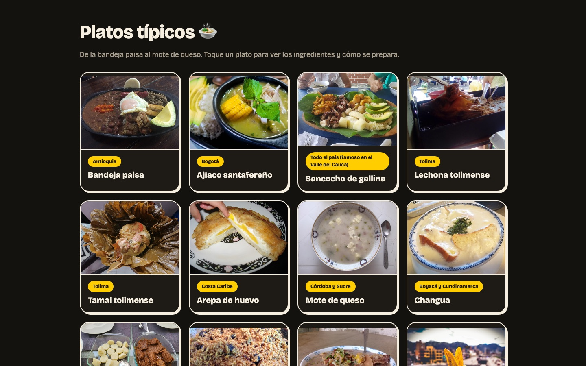

# Parce API 🇨🇴

API pública y gratis de dichos, platos típicos y geografía de Colombia (departamentos, municipios y ríos), con un mapa 3D en la página. Sin llave, sin registro y con CORS abierto.

**[Sitio en vivo](https://parce-api.vercel.app)** · **[Probar la API](https://parce-api.vercel.app/api/dichos/hoy)**



| Platos típicos | Para devs |
|---|---|
|  |  |

<p align="center"></p>

Las fotos de los platos son de Wikimedia Commons; cada plato trae su autor y licencia en `imagen`.

## Endpoints

| Ruta | Qué devuelve |
|---|---|
| `GET /api` | Lista de recursos disponibles |
| `GET /api/dichos` | Todos los dichos. `?q=texto` busca (sin importar tildes) |
| `GET /api/dichos/hoy` | El dicho del día (cambia a medianoche, hora Colombia) |
| `GET /api/dichos/random` | Un dicho al azar |
| `GET /api/dichos/:id` | Un dicho por id |
| `GET /api/platos` | Platos típicos con foto, ingredientes y preparación (también `/hoy`, `/random`, `/:id` y `?q=`) |
| `GET /api/departamentos` | Los 32 departamentos y Bogotá D.C.: código DANE, capital, región, población 2026, superficie, número de municipios y ríos |
| `GET /api/municipios` | Los 1.122 municipios y áreas no municipalizadas de la DIVIPOLA, con coordenadas y población 2026. El `id` es el código DANE: `/api/municipios/05001` |
| `GET /api/rios` | Ríos principales: longitud, desembocadura, vertiente y departamentos que cruzan |
| `GET /mapa/colombia.topo.json` | Fronteras de los departamentos y trazado de los ríos en TopoJSON (69 KB). Cada forma trae el `id` del departamento o río |
| `GET /api/<recurso>?<campo>=valor` | Filtra por cualquier campo, sin importar tildes. Ej. `/api/platos?region=tolima`, `/api/municipios?departamento=boyaca&capital=true`. Si hay coincidencias exactas, solo trae esas: `?departamento=santander` no incluye Norte de Santander. Se combina con `?q=` |

```js
const dicho = await (await fetch('https://parce-api.vercel.app/api/dichos/hoy')).json();
```

## Cómo está hecho

```
parce-api/
├── api/index.js       un solo handler para todos los recursos: lista, /hoy, /random, por id y filtros
├── data/              cada archivo .json es un recurso: dichos.json → /api/dichos, platos.json → /api/platos
├── index.html         la página: HTML, CSS y JS sin frameworks, consume la misma API pública
├── mapa/              colombia.topo.json, las fronteras y ríos que dibuja el mapa
├── scripts/           datos.js y mapa.js regeneran los datos geográficos desde las fuentes oficiales
├── api.test.js        node:test: rutas, búsqueda, filtros y el cambio de día en hora de Colombia
├── vercel.json        reescribe /api/:ruta* hacia la función e incluye data/ en el bundle
└── docs/screenshots/  las imágenes de este README
```

- **Los datos mandan, no el código.** Agregar un recurso es agregar un JSON; el handler no cambia.
- **Una sola responsabilidad por capa.** `data/` guarda el contenido, `api/` lo sirve y `index.html` lo muestra usando la API como cualquier otro cliente.
- **Sin dependencias.** Node puro en el servidor y en los tests, HTML y CSS planos en la página.

## Fuentes de los datos geográficos

- **Departamentos y municipios:** [DIVIPOLA del DANE](https://www.datos.gov.co/d/gdxc-w37w) (CC BY-SA 4.0). Las capitales tienen el código `XX001`, menos Cundinamarca, cuya capital es Bogotá.
- **Población 2026:** [proyecciones de población del DANE](https://www.dane.gov.co/index.php/estadisticas-por-tema/demografia-y-poblacion/proyecciones-de-poblacion) publicadas en 2025, con base en el censo de 2018.
- **Fronteras y superficie:** límites del IGAC de 2024, vía [geoBoundaries](https://www.geoboundaries.org/) (CC BY 4.0). La superficie se calcula sobre esas fronteras.
- **Ríos:** trazado de [Natural Earth](https://www.naturalearthdata.com/) (dominio público); longitud y desembocadura de [Wikidata](https://www.wikidata.org/) (CC0). Los departamentos de cada río salen de cruzar su trazado con las fronteras.

Para regenerarlos, mira las instrucciones al inicio de `scripts/datos.js`.

## Agregar contenido

- **Un dicho nuevo:** agrégalo a `data/dichos.json` con un `id` único en minúsculas y con guiones, y su `region` (`"Todo el país"` si se dice en todas partes). Así sale en `/api/dichos?region=antioquia`.
- **Un recurso nuevo** (ej. postres): crea `data/postres.json` con objetos que tengan `id`. Queda disponible solo en `/api/postres`.

Corre `npm test` antes de hacer commit.

Hecho con ❤️ por [Manuel Cerón](https://manuelceron.vercel.app).
