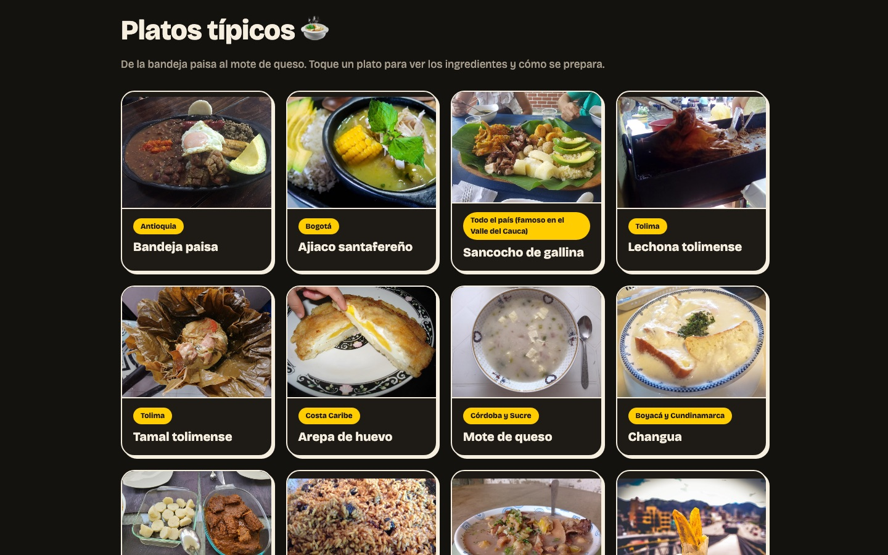
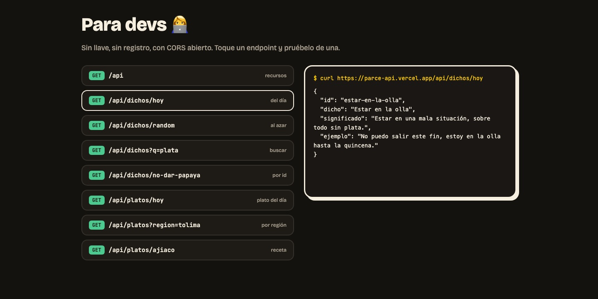
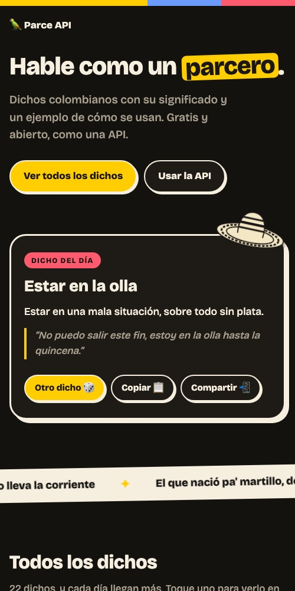

# Parce API 🇨🇴

API pública y gratis de dichos y platos típicos colombianos (y pronto comidas del mundo). Sin llave, sin registro y con CORS abierto.

**[Sitio en vivo](https://parce-api.vercel.app)** · **[Probar la API](https://parce-api.vercel.app/api/dichos/hoy)**


| Platos típicos | Para devs |
|---|---|
|  |  |

<p align="center"></p>

Las fotos de los platos son de Wikimedia Commons; cada plato trae su autor y licencia en `imagen`.

## Endpoints

| Ruta | Qué devuelve |
|---|---|
| `GET /api` | Lista de recursos disponibles |
| `GET /api/dichos` | Todos los dichos. `?q=texto` busca (sin importar tildes) |
| `GET /api/dichos/hoy` | El dicho del día (cambia a medianoche, hora Colombia) |
| `GET /api/dichos/random` | Un dicho al azar |
| `GET /api/dichos/:id` | Un dicho por id |
| `GET /api/platos` | Platos típicos con foto, ingredientes y preparación (también `/hoy`, `/random`, `/:id` y `?q=`) |
| `GET /api/<recurso>?<campo>=valor` | Filtra por cualquier campo, sin importar tildes. Ej. `/api/platos?region=tolima`. Se combina con `?q=` |

```js
const dicho = await (await fetch('https://parce-api.vercel.app/api/dichos/hoy')).json();
```

## Cómo está hecho

```
parce-api/
├── api/index.js       un solo handler para todos los recursos: lista, /hoy, /random, por id y filtros
├── data/              cada archivo .json es un recurso: dichos.json → /api/dichos, platos.json → /api/platos
├── index.html         la página: HTML, CSS y JS sin frameworks, consume la misma API pública
├── api.test.js        node:test: rutas, búsqueda, filtros y el cambio de día en hora de Colombia
├── vercel.json        reescribe /api/:ruta* hacia la función e incluye data/ en el bundle
└── docs/screenshots/  las imágenes de este README
```

- **Los datos mandan, no el código.** Agregar un recurso es agregar un JSON; el handler no cambia.
- **Una sola responsabilidad por capa.** `data/` guarda el contenido, `api/` lo sirve y `index.html` lo muestra usando la API como cualquier otro cliente.
- **Sin dependencias.** Node puro en el servidor y en los tests, HTML y CSS planos en la página.

## Agregar contenido

- **Un dicho nuevo:** agrégalo a `data/dichos.json` con un `id` único en minúsculas y con guiones.
- **Un recurso nuevo** (ej. postres): crea `data/postres.json` con objetos que tengan `id`. Queda disponible solo en `/api/postres`.

Corre `npm test` antes de hacer commit.

Hecho con ❤️ por [Manuel Cerón](https://manuelceron.vercel.app).
